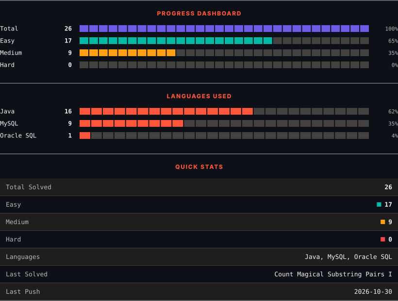
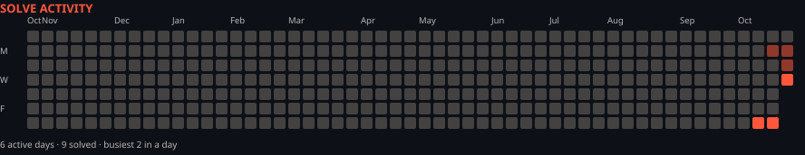

<h1>LeetCode Solutions</h1>

<em>Automatically synced with every accepted submission</em>

   

<picture>
  <source media="(prefers-color-scheme: dark)" srcset=".leetsync/stats-dark.svg">
  <source media="(prefers-color-scheme: light)" srcset=".leetsync/stats-light.svg">
  
</picture>

<picture>
  <source media="(prefers-color-scheme: dark)" srcset=".leetsync/calendar-dark.svg">
  <source media="(prefers-color-scheme: light)" srcset=".leetsync/calendar-light.svg">
  
</picture>

---

### ALL SOLUTIONS

| # | Problem | Difficulty | Language | Date |
|:---:|:--------|:----------:|:--------:|:----:|
| 1 | [Two Sum](problems/0001-Two-Sum) | 🟩 Easy | `Java` | 2026-10-29 |
| 3 | [Longest Substring Without Repeating Characters](problems/0003-Longest-Substring-Without-Repeating-Characters) | 🟧 Medium | `Java` | 2026-10-30 |
| 11 | [Container With Most Water](problems/0011-Container-With-Most-Water) | 🟧 Medium | `Java` | 2026-10-29 |
| 15 | [3Sum](problems/0015-3Sum) | 🟧 Medium | `Java` | 2026-10-30 |
| 53 | [Maximum Subarray](problems/0053-Maximum-Subarray) | 🟧 Medium | `Java` | 2026-10-29 |
| 62 | [Unique Paths](problems/0062-Unique-Paths) | 🟧 Medium | `Java` | 2026-10-31 |
| 63 | [Unique Paths II](problems/0063-Unique-Paths-II) | 🟧 Medium | `Java` | 2026-10-31 |
| 64 | [Minimum Path Sum](problems/0064-Minimum-Path-Sum) | 🟧 Medium | `Java` | 2026-10-31 |
| 74 | [Search a 2D Matrix](problems/0074-Search-a-2D-Matrix) | 🟧 Medium | `Java` | 2026-10-17 |
| 76 | [Minimum Window Substring](problems/0076-Minimum-Window-Substring) | 🟥 Hard | `Java` | 2026-10-31 |
| 120 | [Triangle](problems/0120-Triangle) | 🟧 Medium | `Java` | 2026-10-31 |
| 121 | [Best Time to Buy and Sell Stock](problems/0121-Best-Time-to-Buy-and-Sell-Stock) | 🟩 Easy | `Java` | 2026-10-29 |
| 125 | [Valid Palindrome](problems/0125-Valid-Palindrome) | 🟩 Easy | `Java` | 2026-10-29 |
| 197 | [Rising Temperature](problems/0197-Rising-Temperature) | 🟩 Easy | `MySQL` | 2026-10-29 |
| 200 | [Number of Islands](problems/0200-Number-of-Islands) | 🟧 Medium | `Java` | 2026-10-31 |
| 217 | [Contains Duplicate](problems/0217-Contains-Duplicate) | 🟩 Easy | `Java` | 2026-10-29 |
| 238 | [Product of Array Except Self](problems/0238-Product-of-Array-Except-Self) | 🟧 Medium | `Java` | 2026-10-29 |
| 540 | [Single Element in a Sorted Array](problems/0540-Single-Element-in-a-Sorted-Array) | 🟧 Medium | `Java` | 2026-10-27 |
| 584 | [Find Customer Referee](problems/0584-Find-Customer-Referee) | 🟩 Easy | `MySQL` | 2026-10-28 |
| 595 | [Big Countries](problems/0595-Big-Countries) | 🟩 Easy | `MySQL` | 2026-10-28 |
| 620 | [Not Boring Movies](problems/0620-Not-Boring-Movies) | 🟩 Easy | `MySQL` | 2026-10-29 |
| 733 | [Flood Fill](problems/0733-Flood-Fill) | 🟩 Easy | `Java` | 2026-10-31 |
| 744 | [Find Smallest Letter Greater Than Target](problems/0744-Find-Smallest-Letter-Greater-Than-Target) | 🟩 Easy | `Java` | 2026-10-26 |
| 994 | [Rotting Oranges](problems/0994-Rotting-Oranges) | 🟧 Medium | `Java` | 2026-10-31 |
| 1068 | [Product Sales Analysis I](problems/1068-Product-Sales-Analysis-I) | 🟩 Easy | `MySQL` | 2026-10-28 |
| 1148 | [Article Views I](problems/1148-Article-Views-I) | 🟩 Easy | `MySQL` | 2026-10-28 |
| 1378 | [Replace Employee ID With The Unique Identifier](problems/1378-Replace-Employee-ID-With-The-Unique-Identifier) | 🟩 Easy | `MySQL` | 2026-10-29 |
| 1581 | [Customer Who Visited but Did Not Make Any Transactions](problems/1581-Customer-Who-Visited-but-Did-Not-Make-Any-Transactions) | 🟩 Easy | `MySQL` | 2026-10-29 |
| 1683 | [Invalid Tweets](problems/1683-Invalid-Tweets) | 🟩 Easy | `MySQL` | 2026-10-29 |
| 1757 | [Recyclable and Low Fat Products](problems/1757-Recyclable-and-Low-Fat-Products) | 🟩 Easy | `Oracle SQL` | 2026-10-29 |
| 2089 | [Find Target Indices After Sorting Array](problems/2089-Find-Target-Indices-After-Sorting-Array) | 🟩 Easy | `Java` | 2026-10-19 |
| 2409 | [Count Days Spent Together](problems/2409-Count-Days-Spent-Together) | 🟩 Easy | `Java` | 2026-10-24 |
| 3551 | [Minimum Swaps to Sort by Digit Sum](problems/3551-Minimum-Swaps-to-Sort-by-Digit-Sum) | 🟧 Medium | `Java` | 2026-10-17 |
| 4090 | [Count Magical Substring Pairs I](problems/4090-Count-Magical-Substring-Pairs-I) | 🟧 Medium | `Java` | 2026-10-24 |

---

Auto-synced by <strong>LeetSync</strong> · Built by <a href="https://deveshsamant.in/">Devesh Samant</a>

