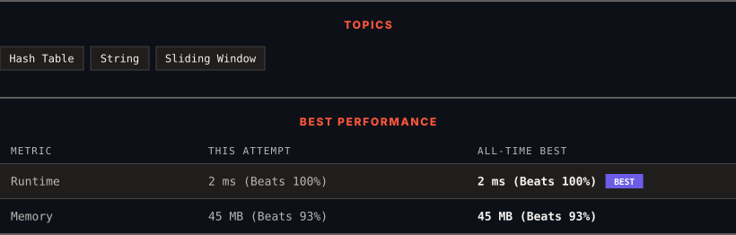

<div align="center">

# 76. Minimum Window Substring

      

[](https://leetcode.com/problems/minimum-window-substring/)

</div>

---

<div align="center">

<picture>
  <source media="(prefers-color-scheme: dark)" srcset="panel-dark.svg">
  <source media="(prefers-color-scheme: light)" srcset="panel-light.svg">
  
</picture>

</div>

> **New personal best** — Runtime improved on this submission.

### HOW IT WENT

| | |
|:--|:--|
| **Attempts** | first try |
| **Time to solve** | 19 h 10 min |
| **Verdicts** | ✅ Accepted |

---

### NOTES

_No notes yet._

---

### SOLUTIONS (1)

| # | File | Language | Date |
|:-:|------|:--------:|:----:|
| 1 | [sol1.java](./sol1.java) | `Java` | 2026-10-31 ← **latest** |

---

### PROBLEM DESCRIPTION

Given two strings `s` and `t` of lengths `m` and `n` respectively, return *the **minimum window*** ***substring**** of *`s`* such that every character in *`t`* (**including duplicates**) is included in the window*. If there is no such substring, return *the empty string *`""`.

The testcases will be generated such that the answer is **unique**.

 

**Example 1:**

```

**Input:** s = "ADOBECODEBANC", t = "ABC"
**Output:** "BANC"
**Explanation:** The minimum window substring "BANC" includes 'A', 'B', and 'C' from string t.

```

**Example 2:**

```

**Input:** s = "a", t = "a"
**Output:** "a"
**Explanation:** The entire string s is the minimum window.

```

**Example 3:**

```

**Input:** s = "a", t = "aa"
**Output:** ""
**Explanation:** Both 'a's from t must be included in the window.
Since the largest window of s only has one 'a', return empty string.

```

 

**Constraints:**

	- `m == s.length`

	- `n == t.length`

	- `1 <= m, n <= 10^5`

	- `s` and `t` consist of uppercase and lowercase English letters.

 

**Follow up:** Could you find an algorithm that runs in `O(m + n)` time?

---

<div align="center">

<sub>Auto-synced by <strong>LeetSync</strong> · Built by <a href="https://deveshsamant.in/">Devesh Samant</a></sub>

</div>
