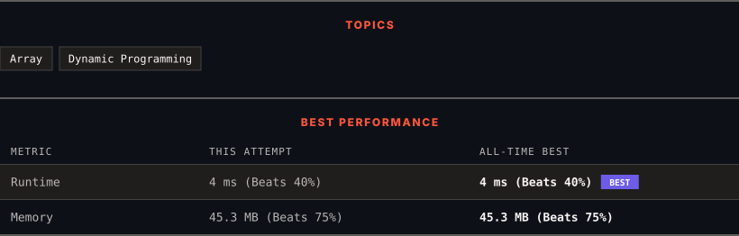

<div align="center">

# 120. Triangle

      

[](https://leetcode.com/problems/triangle/)

</div>

---

<div align="center">

<picture>
  <source media="(prefers-color-scheme: dark)" srcset="panel-dark.svg">
  <source media="(prefers-color-scheme: light)" srcset="panel-light.svg">
  
</picture>

</div>

> **New personal best** — Runtime improved on this submission.

### HOW IT WENT

| | |
|:--|:--|
| **Attempts** | first try |
| **Time to solve** | 15 min |
| **Verdicts** | ✅ Accepted |

---

### NOTES

_No notes yet._

---

### SOLUTIONS (1)

| # | File | Language | Date |
|:-:|------|:--------:|:----:|
| 1 | [sol1.java](./sol1.java) | `Java` | 2026-10-31 ← **latest** |

---

### PROBLEM DESCRIPTION

Given a `triangle` array, return *the minimum path sum from top to bottom*.

For each step, you may move to an adjacent number of the row below. More formally, if you are on index `i` on the current row, you may move to either index `i` or index `i + 1` on the next row.

 

**Example 1:**

```

**Input:** triangle = [[2],[3,4],[6,5,7],[4,1,8,3]]
**Output:** 11
**Explanation:** The triangle looks like:
   2
  3 4
 6 5 7
4 1 8 3
The minimum path sum from top to bottom is 2 + 3 + 5 + 1 = 11 (underlined above).

```

**Example 2:**

```

**Input:** triangle = [[-10]]
**Output:** -10

```

 

**Constraints:**

	- `1 <= triangle.length <= 200`

	- `triangle[0].length == 1`

	- `triangle[i].length == triangle[i - 1].length + 1`

	- `-10^4 <= triangle[i][j] <= 10^4`

 

**Follow up:** Could you do this using only `O(n)` extra space, where `n` is the total number of rows in the triangle?

---

<div align="center">

<sub>Auto-synced by <strong>LeetSync</strong> · Built by <a href="https://deveshsamant.in/">Devesh Samant</a></sub>

</div>
