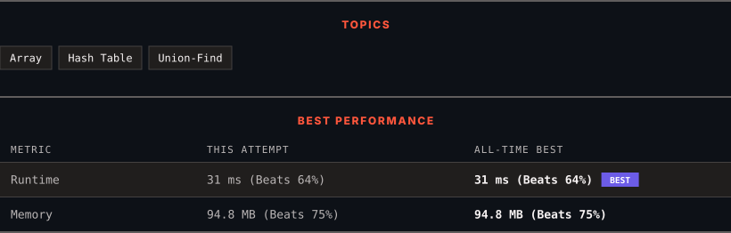

<div align="center">

# 128. Longest Consecutive Sequence

      

[](https://leetcode.com/problems/longest-consecutive-sequence/)

</div>

---

<div align="center">

<picture>
  <source media="(prefers-color-scheme: dark)" srcset="panel-dark.svg">
  <source media="(prefers-color-scheme: light)" srcset="panel-light.svg">
  
</picture>

</div>

> **New personal best** — Runtime improved on this submission.

### HOW IT WENT

| | |
|:--|:--|
| **Attempts** | first try |
| **Time to solve** | under a minute |
| **Verdicts** | ✅ Accepted |

---

### NOTES

_No notes yet._

---

### SOLUTIONS (1)

| # | File | Language | Date |
|:-:|------|:--------:|:----:|
| 1 | [sol1.java](./sol1.java) | `Java` | 2026-11-06 ← **latest** |

---

### PROBLEM DESCRIPTION

Given an unsorted array of integers `nums`, return *the length of the longest consecutive elements sequence.*

You must write an algorithm that runs in `O(n)` time.

 

**Example 1:**

```

**Input:** nums = [100,4,200,1,3,2]
**Output:** 4
**Explanation:** The longest consecutive elements sequence is `[1, 2, 3, 4]`. Therefore its length is 4.

```

**Example 2:**

```

**Input:** nums = [0,3,7,2,5,8,4,6,0,1]
**Output:** 9

```

**Example 3:**

```

**Input:** nums = [1,0,1,2]
**Output:** 3

```

 

**Constraints:**

	- `0 <= nums.length <= 10^5`

	- `-10^9 <= nums[i] <= 10^9`

---

<div align="center">

<sub>Auto-synced by <strong>LeetSync</strong> · Built by <a href="https://deveshsamant.in/">Devesh Samant</a></sub>

</div>
