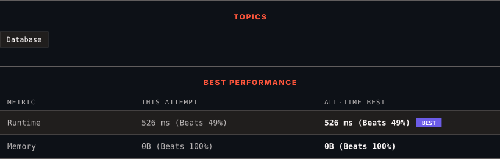

<div align="center">

# 197. Rising Temperature

      

[](https://leetcode.com/problems/rising-temperature/)

</div>

---

<div align="center">

<picture>
  <source media="(prefers-color-scheme: dark)" srcset="panel-dark.svg">
  <source media="(prefers-color-scheme: light)" srcset="panel-light.svg">
  
</picture>

</div>

> **New personal best** — Runtime improved on this submission.

### HOW IT WENT

| | |
|:--|:--|
| **Attempts** | first try |
| **Time to solve** | under a minute |
| **Verdicts** | ✅ Accepted |

---

### NOTES

_No notes yet._

---

### SOLUTIONS (1)

| # | File | Language | Date |
|:-:|------|:--------:|:----:|
| 1 | [sol1.sql](./sol1.sql) | `MySQL` | 2026-10-29 ← **latest** |

---

### PROBLEM DESCRIPTION

Table: `Weather`

```

+---------------+---------+
| Column Name   | Type    |
+---------------+---------+
| id            | int     |
| recordDate    | date    |
| temperature   | int     |
+---------------+---------+
id is the column with unique values for this table.
There are no different rows with the same recordDate.
This table contains information about the temperature on a certain day.

```

 

Write a solution to find all dates' `id` with higher temperatures compared to its previous dates (yesterday).

Return the result table in **any order**.

The result format is in the following example.

 

**Example 1:**

```

**Input:** 
Weather table:
+----+------------+-------------+
| id | recordDate | temperature |
+----+------------+-------------+
| 1  | 2015-01-01 | 10          |
| 2  | 2015-01-02 | 25          |
| 3  | 2015-01-03 | 20          |
| 4  | 2015-01-04 | 30          |
+----+------------+-------------+
**Output:** 
+----+
| id |
+----+
| 2  |
| 4  |
+----+
**Explanation:** 
In 2015-01-02, the temperature was higher than the previous day (10 -> 25).
In 2015-01-04, the temperature was higher than the previous day (20 -> 30).

```

---

<div align="center">

<sub>Auto-synced by <strong>LeetSync</strong> · Built by <a href="https://deveshsamant.in/">Devesh Samant</a></sub>

</div>
