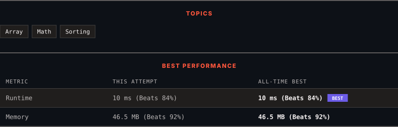

<div align="center">

# 462. Minimum Moves to Equal Array Elements II

      

[](https://leetcode.com/problems/minimum-moves-to-equal-array-elements-ii/)

</div>

---

<div align="center">

<picture>
  <source media="(prefers-color-scheme: dark)" srcset="panel-dark.svg">
  <source media="(prefers-color-scheme: light)" srcset="panel-light.svg">
  
</picture>

</div>

> **New personal best** — Runtime improved on this submission.

### HOW IT WENT

| | |
|:--|:--|
| **Attempts** | 2 before accepted |
| **Time to solve** | 6 h 32 min |
| **Verdicts** | ❌ Wrong Answer → ✅ Accepted |

---

### NOTES

_No notes yet._

---

### SOLUTIONS (1)

| # | File | Language | Date |
|:-:|------|:--------:|:----:|
| 1 | [sol1.java](./sol1.java) | `Java` | 2026-11-02 ← **latest** |

---

### PROBLEM DESCRIPTION

Given an integer array `nums` of size `n`, return *the minimum number of moves required to make all array elements equal*.

In one move, you can increment or decrement an element of the array by `1`.

Test cases are designed so that the answer will fit in a **32-bit** integer.

 

**Example 1:**

```

**Input:** nums = [1,2,3]
**Output:** 2
**Explanation:**
Only two moves are needed (remember each move increments or decrements one element):
[1,2,3]  =>  [2,2,3]  =>  [2,2,2]

```

**Example 2:**

```

**Input:** nums = [1,10,2,9]
**Output:** 16

```

 

**Constraints:**

	- `n == nums.length`

	- `1 <= nums.length <= 10^5`

	- `-10^9 <= nums[i] <= 10^9`

---

<div align="center">

<sub>Auto-synced by <strong>LeetSync</strong> · Built by <a href="https://deveshsamant.in/">Devesh Samant</a></sub>

</div>
