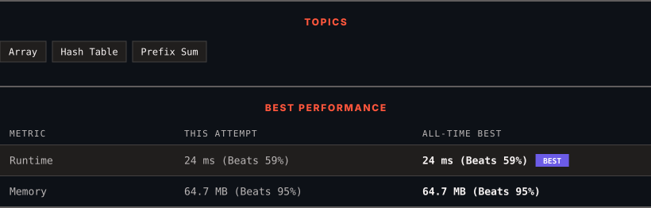

<div align="center">

# 525. Contiguous Array

      

[](https://leetcode.com/problems/contiguous-array/)

</div>

---

<div align="center">

<picture>
  <source media="(prefers-color-scheme: dark)" srcset="panel-dark.svg">
  <source media="(prefers-color-scheme: light)" srcset="panel-light.svg">
  
</picture>

</div>

> **New personal best** — Runtime improved on this submission.

### HOW IT WENT

| | |
|:--|:--|
| **Attempts** | first try |
| **Time to solve** | 36 min |
| **Verdicts** | ✅ Accepted |

---

### NOTES

_No notes yet._

---

### SOLUTIONS (1)

| # | File | Language | Date |
|:-:|------|:--------:|:----:|
| 1 | [sol1.java](./sol1.java) | `Java` | 2026-11-01 ← **latest** |

---

### PROBLEM DESCRIPTION

Given a binary array `nums`, return *the maximum length of a contiguous subarray with an equal number of *`0`* and *`1`.

 

**Example 1:**

```

**Input:** nums = [0,1]
**Output:** 2
**Explanation:** [0, 1] is the longest contiguous subarray with an equal number of 0 and 1.

```

**Example 2:**

```

**Input:** nums = [0,1,0]
**Output:** 2
**Explanation:** [0, 1] (or [1, 0]) is a longest contiguous subarray with equal number of 0 and 1.

```

**Example 3:**

```

**Input:** nums = [0,1,1,1,1,1,0,0,0]
**Output:** 6
**Explanation:** [1,1,1,0,0,0] is the longest contiguous subarray with equal number of 0 and 1.

```

 

**Constraints:**

	- `1 <= nums.length <= 10^5`

	- `nums[i]` is either `0` or `1`.

---

<div align="center">

<sub>Auto-synced by <strong>LeetSync</strong> · Built by <a href="https://deveshsamant.in/">Devesh Samant</a></sub>

</div>
