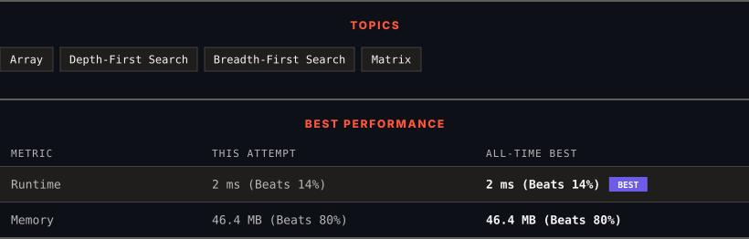

# 733. Flood Fill

      

---

<picture>
  <source media="(prefers-color-scheme: dark)" srcset="panel-dark.svg">
  <source media="(prefers-color-scheme: light)" srcset="panel-light.svg">
  
</picture>

> **New personal best** — Runtime improved on this submission.

### HOW IT WENT

| | |
|:--|:--|
| **Attempts** | first try |
| **Time to solve** | 160 h 42 min |
| **Verdicts** | ✅ Accepted |

---

### NOTES

_No notes yet._

---

### SOLUTIONS (1)

| # | File | Language | Date |
|:-:|------|:--------:|:----:|
| 1 | [sol1.java](./sol1.java) | `Java` | 2026-10-31 ← **latest** |

---

### PROBLEM DESCRIPTION

You are given an image represented by an `m x n` grid of integers `image`, where `image[i][j]` represents the pixel value of the image. You are also given three integers `sr`, `sc`, and `color`. Your task is to perform a **flood fill** on the image starting from the pixel `image[sr][sc]`.

To perform a **flood fill**:

	- Begin with the starting pixel and change its color to `color`.

	- Perform the same process for each pixel that is **directly adjacent** (pixels that share a side with the original pixel, either horizontally or vertically) and shares the **same color** as the starting pixel.

	- Keep **repeating** this process by checking neighboring pixels of the *updated* pixels and modifying their color if it matches the original color of the starting pixel.

	- The process **stops** when there are **no more** adjacent pixels of the original color to update.

Return the **modified** image after performing the flood fill.

 

**Example 1:**

**Input:** image = [[1,1,1],[1,1,0],[1,0,1]], sr = 1, sc = 1, color = 2

**Output:** [[2,2,2],[2,2,0],[2,0,1]]

**Explanation:**

From the center of the image with position `(sr, sc) = (1, 1)` (i.e., the red pixel), all pixels connected by a path of the same color as the starting pixel (i.e., the blue pixels) are colored with the new color.

Note the bottom corner is **not** colored 2, because it is not horizontally or vertically connected to the starting pixel.

**Example 2:**

**Input:** image = [[0,0,0],[0,0,0]], sr = 0, sc = 0, color = 0

**Output:** [[0,0,0],[0,0,0]]

**Explanation:**

The starting pixel is already colored with 0, which is the same as the target color. Therefore, no changes are made to the image.

 

**Constraints:**

	- `m == image.length`

	- `n == image[i].length`

	- `1 <= m, n <= 50`

	- `0 <= image[i][j], color < 2^16`

	- `0 <= sr < m`

	- `0 <= sc < n`

---

Auto-synced by <strong>LeetSync</strong> · Built by <a href="https://deveshsamant.in/">Devesh Samant</a>

