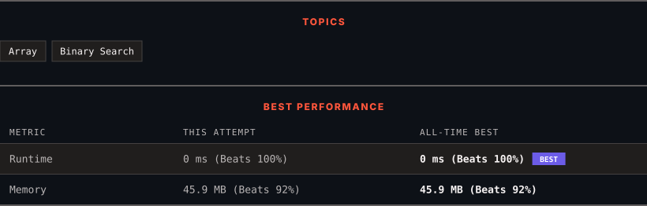

<div align="center">

# 744. Find Smallest Letter Greater Than Target

      

[](https://leetcode.com/problems/find-smallest-letter-greater-than-target/)

</div>

---

<div align="center">

<picture>
  <source media="(prefers-color-scheme: dark)" srcset="panel-dark.svg">
  <source media="(prefers-color-scheme: light)" srcset="panel-light.svg">
  
</picture>

</div>

> **New personal best** — Runtime improved on this submission.

### HOW IT WENT

| | |
|:--|:--|
| **Attempts** | 2 before accepted |
| **Time to solve** | 1 h 7 min |
| **Verdicts** | ❌ Wrong Answer → ✅ Accepted |

---

### NOTES

_No notes yet._

---

### SOLUTIONS (1)

| # | File | Language | Date |
|:-:|------|:--------:|:----:|
| 1 | [sol1.java](./sol1.java) | `Java` | 2026-10-26 ← **latest** |

---

### PROBLEM DESCRIPTION

You are given an array of characters `letters` that is sorted in **non-decreasing order**, and a character `target`. There are **at least two different** characters in `letters`.

Return *the smallest character in *`letters`* that is lexicographically greater than *`target`. If such a character does not exist, return the first character in `letters`.

 

**Example 1:**

```

**Input:** letters = ["c","f","j"], target = "a"
**Output:** "c"
**Explanation:** The smallest character that is lexicographically greater than 'a' in letters is 'c'.

```

**Example 2:**

```

**Input:** letters = ["c","f","j"], target = "c"
**Output:** "f"
**Explanation:** The smallest character that is lexicographically greater than 'c' in letters is 'f'.

```

**Example 3:**

```

**Input:** letters = ["x","x","y","y"], target = "z"
**Output:** "x"
**Explanation:** There are no characters in letters that is lexicographically greater than 'z' so we return letters[0].

```

 

**Constraints:**

	- `2 <= letters.length <= 10^4`

	- `letters[i]` is a lowercase English letter.

	- `letters` is sorted in **non-decreasing** order.

	- `letters` contains at least two different characters.

	- `target` is a lowercase English letter.

---

<div align="center">

<sub>Auto-synced by <strong>LeetSync</strong> · Built by <a href="https://deveshsamant.in/">Devesh Samant</a></sub>

</div>
