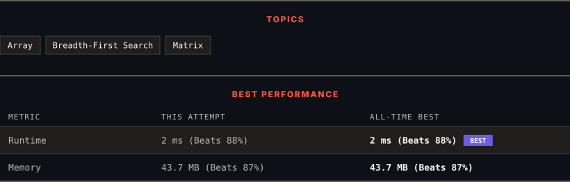

<div align="center">

# 994. Rotting Oranges

      

[](https://leetcode.com/problems/rotting-oranges/)

</div>

---

<div align="center">

<picture>
  <source media="(prefers-color-scheme: dark)" srcset="panel-dark.svg">
  <source media="(prefers-color-scheme: light)" srcset="panel-light.svg">
  
</picture>

</div>

> **New personal best** — Runtime improved on this submission.

### HOW IT WENT

| | |
|:--|:--|
| **Attempts** | first try |
| **Time to solve** | 34 min |
| **Verdicts** | ✅ Accepted |

---

### NOTES

_No notes yet._

---

### SOLUTIONS (1)

| # | File | Language | Date |
|:-:|------|:--------:|:----:|
| 1 | [sol1.java](./sol1.java) | `Java` | 2026-10-31 ← **latest** |

---

### PROBLEM DESCRIPTION

You are given an `m x n` `grid` where each cell can have one of three values:

	- `0` representing an empty cell,

	- `1` representing a fresh orange, or

	- `2` representing a rotten orange.

Every minute, any fresh orange that is **4-directionally adjacent** to a rotten orange becomes rotten.

Return *the minimum number of minutes that must elapse until no cell has a fresh orange*. If *this is impossible, return* `-1`.

 

**Example 1:**


```

**Input:** grid = [[2,1,1],[1,1,0],[0,1,1]]
**Output:** 4

```

**Example 2:**

```

**Input:** grid = [[2,1,1],[0,1,1],[1,0,1]]
**Output:** -1
**Explanation:** The orange in the bottom left corner (row 2, column 0) is never rotten, because rotting only happens 4-directionally.

```

**Example 3:**

```

**Input:** grid = [[0,2]]
**Output:** 0
**Explanation:** Since there are already no fresh oranges at minute 0, the answer is just 0.

```

 

**Constraints:**

	- `m == grid.length`

	- `n == grid[i].length`

	- `1 <= m, n <= 10`

	- `grid[i][j]` is `0`, `1`, or `2`.

---

<div align="center">

<sub>Auto-synced by <strong>LeetSync</strong> · Built by <a href="https://deveshsamant.in/">Devesh Samant</a></sub>

</div>
