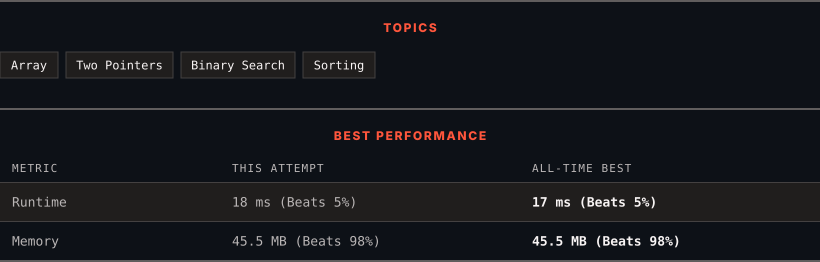

<div align="center">

# 1385. Find the Distance Value Between Two Arrays

      

[](https://leetcode.com/problems/find-the-distance-value-between-two-arrays/)

</div>

---

<div align="center">

<picture>
  <source media="(prefers-color-scheme: dark)" srcset="panel-dark.svg">
  <source media="(prefers-color-scheme: light)" srcset="panel-light.svg">
  
</picture>

</div>

> **New personal best** — Runtime improved on this submission.

### HOW IT WENT

| | |
|:--|:--|
| **Attempts** | 3 before accepted |
| **Time to solve** | 2 h 22 min |
| **Verdicts** | ✅ Accepted → ✅ Accepted → ✅ Accepted |

---

### NOTES

_No notes yet._

---

### SOLUTIONS (3)

| # | File | Language | Date |
|:-:|------|:--------:|:----:|
| 1 | [sol1.java](./sol1.java) | `Java` | 2026-11-05 |
| 2 | [sol2.java](./sol2.java) | `Java` | 2026-11-05 |
| 3 | [sol3.java](./sol3.java) | `Java` | 2026-11-05 ← **latest** |

---

### PROBLEM DESCRIPTION

Given two integer arrays `arr1` and `arr2`, and the integer `d`, *return the distance value between the two arrays*.

The distance value is defined as the number of elements `arr1[i]` such that there is not any element `arr2[j]` where `|arr1[i]-arr2[j]| <= d`.

 

**Example 1:**

```

**Input:** arr1 = [4,5,8], arr2 = [10,9,1,8], d = 2
**Output:** 2
**Explanation:** 
For arr1[0]=4 we have: 
|4-10|=6 > d=2 
|4-9|=5 > d=2 
|4-1|=3 > d=2 
|4-8|=4 > d=2 
For arr1[1]=5 we have: 
|5-10|=5 > d=2 
|5-9|=4 > d=2 
|5-1|=4 > d=2 
|5-8|=3 > d=2
For arr1[2]=8 we have:
**|8-10|=2 <= d=2**
**|8-9|=1 <= d=2**
|8-1|=7 > d=2
**|8-8|=0 <= d=2**

```

**Example 2:**

```

**Input:** arr1 = [1,4,2,3], arr2 = [-4,-3,6,10,20,30], d = 3
**Output:** 2

```

**Example 3:**

```

**Input:** arr1 = [2,1,100,3], arr2 = [-5,-2,10,-3,7], d = 6
**Output:** 1

```

 

**Constraints:**

	- `1 <= arr1.length, arr2.length <= 500`

	- `-1000 <= arr1[i], arr2[j] <= 1000`

	- `0 <= d <= 100`

---

<div align="center">

<sub>Auto-synced by <strong>LeetSync</strong> · Built by <a href="https://deveshsamant.in/">Devesh Samant</a></sub>

</div>
