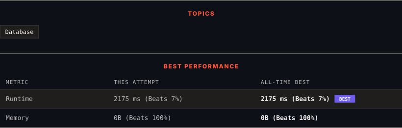

<div align="center">

# 1581. Customer Who Visited but Did Not Make Any Transactions

      

[](https://leetcode.com/problems/customer-who-visited-but-did-not-make-any-transactions/)

</div>

---

<div align="center">

<picture>
  <source media="(prefers-color-scheme: dark)" srcset="panel-dark.svg">
  <source media="(prefers-color-scheme: light)" srcset="panel-light.svg">
  
</picture>

</div>

> **New personal best** — Runtime improved on this submission.

### HOW IT WENT

| | |
|:--|:--|
| **Attempts** | first try |
| **Time to solve** | under a minute |
| **Verdicts** | ✅ Accepted |

---

### NOTES

_No notes yet._

---

### SOLUTIONS (1)

| # | File | Language | Date |
|:-:|------|:--------:|:----:|
| 1 | [sol1.sql](./sol1.sql) | `MySQL` | 2026-10-29 ← **latest** |

---

### PROBLEM DESCRIPTION

Table: `Visits`

```

+-------------+---------+
| Column Name | Type    |
+-------------+---------+
| visit_id    | int     |
| customer_id | int     |
+-------------+---------+
visit_id is the column with unique values for this table.
This table contains information about the customers who visited the mall.

```

 

Table: `Transactions`

```

+----------------+---------+
| Column Name    | Type    |
+----------------+---------+
| transaction_id | int     |
| visit_id       | int     |
| amount         | int     |
+----------------+---------+
transaction_id is column with unique values for this table.
This table contains information about the transactions made during the visit_id.

```

 

Write a solution to find the IDs of the users who visited without making any transactions and the number of times they made these types of visits.

Return the result table sorted in **any order**.

The result format is in the following example.

 

**Example 1:**

```

**Input:** 
Visits
+----------+-------------+
| visit_id | customer_id |
+----------+-------------+
| 1        | 23          |
| 2        | 9           |
| 4        | 30          |
| 5        | 54          |
| 6        | 96          |
| 7        | 54          |
| 8        | 54          |
+----------+-------------+
Transactions
+----------------+----------+--------+
| transaction_id | visit_id | amount |
+----------------+----------+--------+
| 2              | 5        | 310    |
| 3              | 5        | 300    |
| 9              | 5        | 200    |
| 12             | 1        | 910    |
| 13             | 2        | 970    |
+----------------+----------+--------+
**Output:** 
+-------------+----------------+
| customer_id | count_no_trans |
+-------------+----------------+
| 54          | 2              |
| 30          | 1              |
| 96          | 1              |
+-------------+----------------+
**Explanation:** 
Customer with id = 23 visited the mall once and made one transaction during the visit with id = 12.
Customer with id = 9 visited the mall once and made one transaction during the visit with id = 13.
Customer with id = 30 visited the mall once and did not make any transactions.
Customer with id = 54 visited the mall three times. During 2 visits they did not make any transactions, and during one visit they made 3 transactions.
Customer with id = 96 visited the mall once and did not make any transactions.
As we can see, users with IDs 30 and 96 visited the mall one time without making any transactions. Also, user 54 visited the mall twice and did not make any transactions.

```

---

<div align="center">

<sub>Auto-synced by <strong>LeetSync</strong> · Built by <a href="https://deveshsamant.in/">Devesh Samant</a></sub>

</div>
