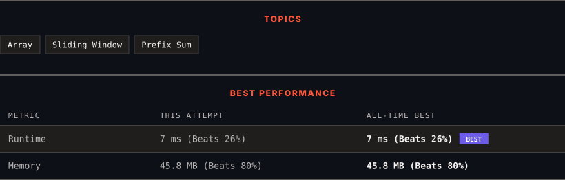

# 3364. Minimum Positive Sum Subarray 

      

---

<picture>
  <source media="(prefers-color-scheme: dark)" srcset="panel-dark.svg">
  <source media="(prefers-color-scheme: light)" srcset="panel-light.svg">
  
</picture>

> **New personal best** — Runtime improved on this submission.

### HOW IT WENT

| | |
|:--|:--|
| **Attempts** | first try |
| **Time to solve** | 5 h 31 min |
| **Verdicts** | ✅ Accepted |

---

### NOTES

_No notes yet._

---

### SOLUTIONS (1)

| # | File | Language | Date |
|:-:|------|:--------:|:----:|
| 1 | [sol1.java](./sol1.java) | `Java` | 2026-11-14 ← **latest** |

---

### PROBLEM DESCRIPTION

You are given an integer array `nums` and **two** integers `l` and `r`. Your task is to find the **minimum** sum of a **subarray** whose size is between `l` and `r` (inclusive) and whose sum is greater than 0.

Return the **minimum** sum of such a subarray. If no such subarray exists, return -1.

A **subarray** is a contiguous **non-empty** sequence of elements within an array.

 

**Example 1:**

**Input:** nums = [3, -2, 1, 4], l = 2, r = 3

**Output:** 1

**Explanation:**

The subarrays of length between `l = 2` and `r = 3` where the sum is greater than 0 are:

	- `[3, -2]` with a sum of 1

	- `[1, 4]` with a sum of 5

	- `[3, -2, 1]` with a sum of 2

	- `[-2, 1, 4]` with a sum of 3

Out of these, the subarray `[3, -2]` has a sum of 1, which is the smallest positive sum. Hence, the answer is 1.

**Example 2:**

**Input:** nums = [-2, 2, -3, 1], l = 2, r = 3

**Output:** -1

**Explanation:**

There is no subarray of length between `l` and `r` that has a sum greater than 0. So, the answer is -1.

**Example 3:**

**Input:** nums = [1, 2, 3, 4], l = 2, r = 4

**Output:** 3

**Explanation:**

The subarray `[1, 2]` has a length of 2 and the minimum sum greater than 0. So, the answer is 3.

 

**Constraints:**

	- `1 <= nums.length <= 100`

	- `1 <= l <= r <= nums.length`

	- `-1000 <= nums[i] <= 1000`

---

Auto-synced by <strong>LeetSync</strong> · Built by <a href="https://deveshsamant.in/">Devesh Samant</a>

