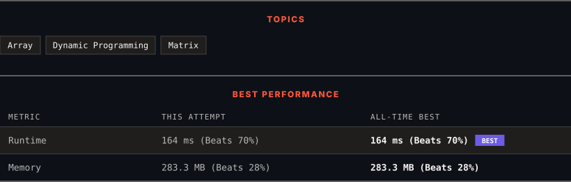

# 3665. Twisted Mirror Path Count

      

---

<picture>
  <source media="(prefers-color-scheme: dark)" srcset="panel-dark.svg">
  <source media="(prefers-color-scheme: light)" srcset="panel-light.svg">
  
</picture>

> **New personal best** — Runtime improved on this submission.

### HOW IT WENT

| | |
|:--|:--|
| **Attempts** | first try |
| **Time to solve** | 1 h 49 min |
| **Verdicts** | ✅ Accepted |

---

### NOTES

_No notes yet._

---

### SOLUTIONS (1)

| # | File | Language | Date |
|:-:|------|:--------:|:----:|
| 1 | [sol1.java](./sol1.java) | `Java` | 2026-10-31 ← **latest** |

---

### PROBLEM DESCRIPTION

Given an `m x n` binary grid `grid` where:

	- `grid[i][j] == 0` represents an empty cell, and

	- `grid[i][j] == 1` represents a mirror.

A robot starts at the top-left corner of the grid `(0, 0)` and wants to reach the bottom-right corner `(m - 1, n - 1)`. It can move only **right** or **down**. If the robot attempts to move into a mirror cell, it is **reflected** before entering that cell:

	- If it tries to move **right** into a mirror, it is turned **down** and moved into the cell directly below the mirror.

	- If it tries to move **down** into a mirror, it is turned **right** and moved into the cell directly to the right of the mirror.

If this reflection would cause the robot to move outside the `grid` boundaries, the path is considered invalid and should not be counted.

Return the number of unique valid paths from `(0, 0)` to `(m - 1, n - 1)`.

Since the answer may be very large, return it **modulo** `10^9 + 7`.

**Note**: If a reflection moves the robot into a mirror cell, the robot is immediately reflected again based on the direction it used to enter that mirror: if it entered while moving right, it will be turned down; if it entered while moving down, it will be turned right. This process will continue until either the last cell is reached, the robot moves out of bounds or the robot moves to a non-mirror cell.

 

**Example 1:**

**Input:** grid = [[0,1,0],[0,0,1],[1,0,0]]

**Output:** 5

**Explanation:**

	
		
			Number
			Full Path
		
	
	
		
			1
			(0, 0) &rarr; (0, 1) [M] &rarr; (1, 1) &rarr; (1, 2) [M] &rarr; (2, 2)
		
		
			2
			(0, 0) &rarr; (0, 1) [M] &rarr; (1, 1) &rarr; (2, 1) &rarr; (2, 2)
		
		
			3
			(0, 0) &rarr; (1, 0) &rarr; (1, 1) &rarr; (1, 2) [M] &rarr; (2, 2)
		
		
			4
			(0, 0) &rarr; (1, 0) &rarr; (1, 1) &rarr; (2, 1) &rarr; (2, 2)
		
		
			5
			(0, 0) &rarr; (1, 0) &rarr; (2, 0) [M] &rarr; (2, 1) &rarr; (2, 2)
		
	

	- 
	`[M]` indicates the robot attempted to enter a mirror cell and instead reflected.

	

**Example 2:**

**Input:** grid = [[0,0],[0,0]]

**Output:** 2

**Explanation:**

	
		
			Number
			Full Path
		
	
	
		
			1
			(0, 0) &rarr; (0, 1) &rarr; (1, 1)
		
		
			2
			(0, 0) &rarr; (1, 0) &rarr; (1, 1)
		
	

**Example 3:**

**Input:** grid = [[0,1,1],[1,1,0]]

**Output:** 1

**Explanation:**

	
		
			Number
			Full Path
		
	
	
		
			1
			(0, 0) &rarr; (0, 1) [M] &rarr; (1, 1) [M] &rarr; (1, 2)
		
	

`(0, 0) &rarr; (1, 0) [M] &rarr; (1, 1) [M] &rarr; (2, 1)` goes out of bounds, so it is invalid.

 

**Constraints:**

	- `m == grid.length`

	- `n == grid[i].length`

	- `2 <= m, n <= 500`

	- `grid[i][j]` is either `0` or `1`.

	- `grid[0][0] == grid[m - 1][n - 1] == 0`

---

Auto-synced by <strong>LeetSync</strong> · Built by <a href="https://deveshsamant.in/">Devesh Samant</a>

