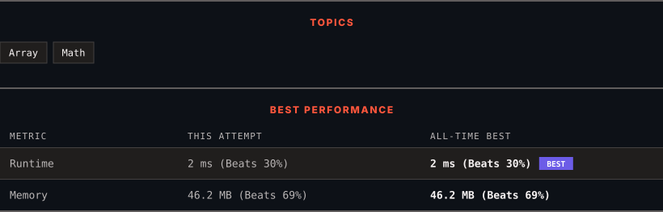

# 3736. Minimum Moves to Equal Array Elements III

      

---

<picture>
  <source media="(prefers-color-scheme: dark)" srcset="panel-dark.svg">
  <source media="(prefers-color-scheme: light)" srcset="panel-light.svg">
  
</picture>

> **New personal best** — Runtime improved on this submission.

### HOW IT WENT

| | |
|:--|:--|
| **Attempts** | first try |
| **Time to solve** | 11 min |
| **Verdicts** | ✅ Accepted |

---

### NOTES

_No notes yet._

---

### SOLUTIONS (1)

| # | File | Language | Date |
|:-:|------|:--------:|:----:|
| 1 | [sol1.java](./sol1.java) | `Java` | 2026-11-03 ← **latest** |

---

### PROBLEM DESCRIPTION

You are given an integer array `nums`.

In one move, you may **increase** the value of any single element `nums[i]` by 1.

Return the **minimum total** number of **moves** required so that all elements in `nums` become **equal**.

 

**Example 1:**

**Input:** nums = [2,1,3]

**Output:** 3

**Explanation:**

To make all elements equal:

	- Increase `nums[0] = 2` by 1 to make it 3.

	- Increase `nums[1] = 1` by 1 to make it 2.

	- Increase `nums[1] = 2` by 1 to make it 3.

Now, all elements of `nums` are equal to 3. The minimum total moves is `3`.

**Example 2:**

**Input:** nums = [4,4,5]

**Output:** 2

**Explanation:**

To make all elements equal:

	- Increase `nums[0] = 4` by 1 to make it 5.

	- Increase `nums[1] = 4` by 1 to make it 5.

Now, all elements of `nums` are equal to 5. The minimum total moves is `2`.

 

**Constraints:**

	- `1 <= nums.length <= 100`

	- `1 <= nums[i] <= 100`

---

Auto-synced by <strong>LeetSync</strong> · Built by <a href="https://deveshsamant.in/">Devesh Samant</a>

